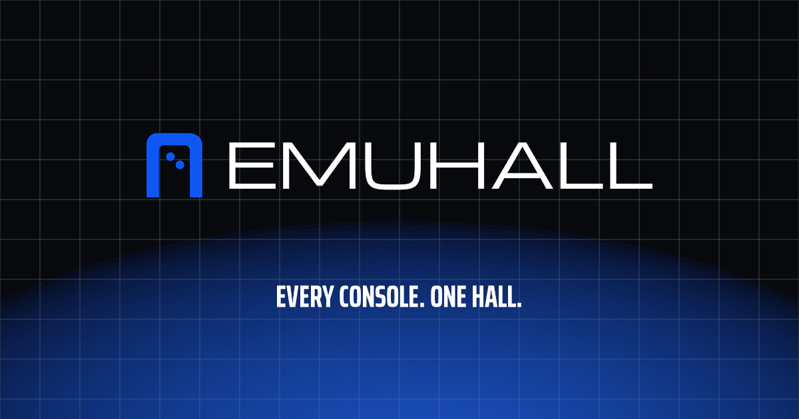
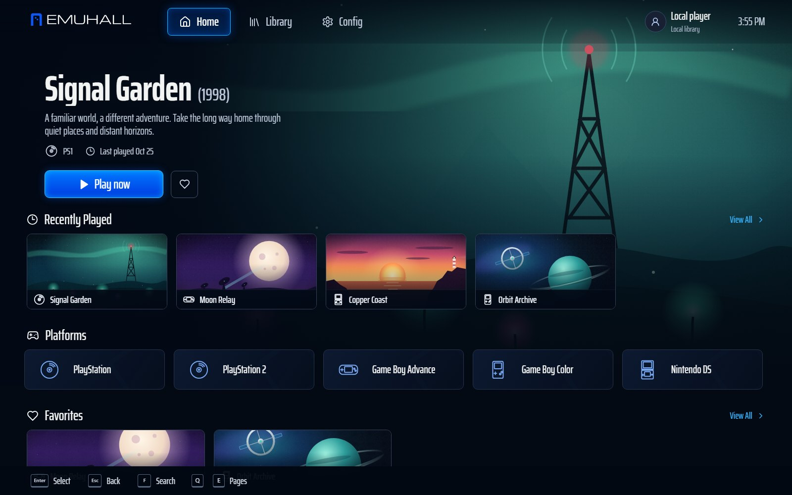
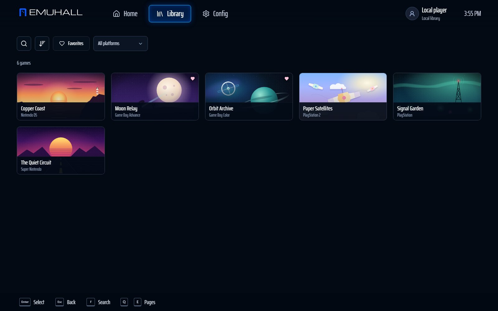
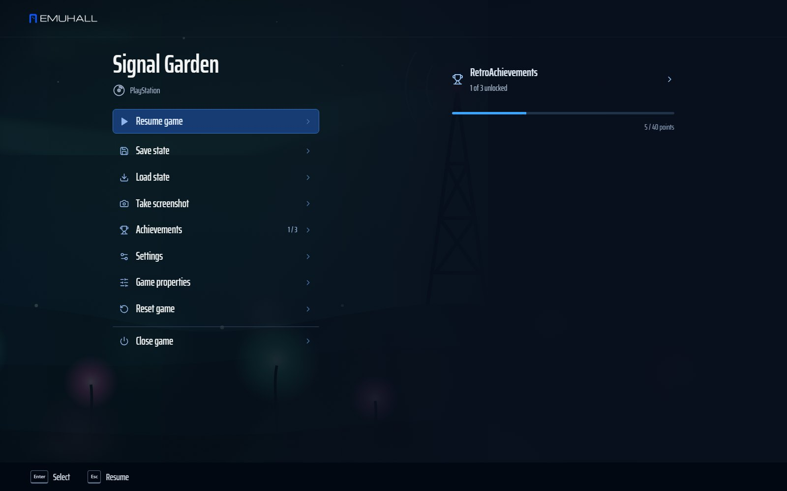
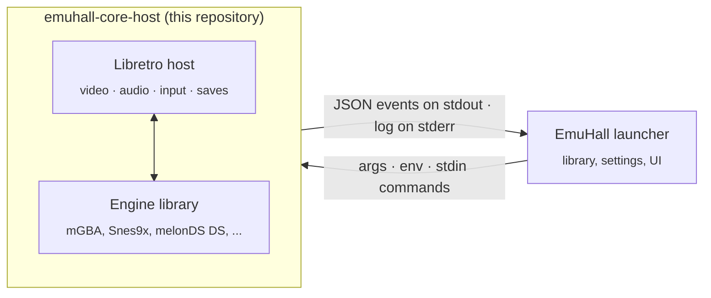

<div align="center">

<a href="https://getemuhall.com"></a>

# EmuHall

**Every console. One hall.**<br />
A free, controller-first game library and emulation app, and the open-source player that runs it.

[](LICENSE)
[](rust-toolchain.toml)
[](#platform-support)
[](third-party/libretro)

[Website](https://getemuhall.com) · [Download](https://getemuhall.com/download/) · [Credits](https://getemuhall.com/credits/) · [Contributing](CONTRIBUTING.md) · [Security](SECURITY.md)

</div>

---

## Your games. Right at home.

EmuHall is a **free, controller-first game library and emulation app**. Point it at your games folder and it recognizes what you have, fetches covers, picks the right engine for every console and lets you play all of it from one place, from the couch, with a controller.

<table><tr>
<td width="33%"></td>
<td width="33%"></td>
<td width="33%"></td>
</tr></table>

- **13 consoles, one app.** NES, SNES, N64, Game Boy, Game Boy Color, Game Boy Advance, DS, 3DS, PlayStation, PlayStation 2, Mega Drive, Master System and Game Gear.
- **Made for a controller.** Every screen works with a gamepad; Xbox, PlayStation, Switch and generic pads are recognized with their own button prompts.
- **A real pause menu.** Ten save-state slots with previews, rewind, disc swapping, screenshots, cheats and your play time, one button away.
- **RetroAchievements** built in, with progress and challenge indicators.
- **Cheats that just work.** Paste codes or whole GameHacking.org / libretro cheat files.
- **Portable and private.** No account needed, no ads, no tracking. Your library and saves stay in one folder you can carry on a USB drive.

**[Download EmuHall for Windows or Linux →](https://getemuhall.com/download/)**

> EmuHall does not include games, BIOS files or console keys, and it does not decrypt games. You bring your own legally obtained, already-decrypted game files.

## What this repository is

This is the open-source part of EmuHall that actually plays games: `emuhall-core-host`, a small native program that loads a single [Libretro](https://www.libretro.com/) engine (an emulator "core"), runs one game and presents it. Releases of EmuHall are published here too.

The EmuHall launcher starts one player per game and talks to it only through command-line arguments, environment variables and pipes. If an engine crashes or hangs, only its player process goes down; the launcher stays open and offers to try again.



The player is published in full because it shares a process with GPL-licensed engines. It is MIT-licensed, which is GPL-compatible, so you can read, build, audit and reuse it.

## Player features

| Area | What the player does |
|---|---|
| **Video** | OpenGL 3.3+ core contexts, Direct3D 11 and 12, Vulkan (context negotiation v1) and software frames, presented on the display's real vblank with a three-frame queue. Integer and aspect-correct scaling, smoothing, CRT and LCD looks. |
| **Audio** | 48 kHz output with dynamic rate control and time stretching, so audio neither crackles nor drifts. |
| **Input** | SDL3 controllers (Xbox, PlayStation 3/4/5, Switch, generic) with XInput fallback, up to four ports with per-device profiles, analog sticks and triggers, rumble, keyboard remapping and mouse-as-touchscreen for DS. |
| **Saves** | Battery saves that follow the game across engines. Save states in a verified envelope recording game, engine build, platform and payload checksum. Separate resume states written only after a verified save. |
| **Time** | Bounded in-memory rewind, fast forward, and runahead for engine builds that pass a canonical output comparison. All off by default. |
| **Achievements** | [RetroAchievements](https://retroachievements.org) through the official `rcheevos` client: sign-in by token, game identification, unlocks, progress, hardcore rules. |
| **Cheats** | Engine cheats plus typed data-memory cheats where the platform's byte order is known. Disabled in hardcore and netplay. |
| **Netplay** | An original two-player delayed-lockstep protocol over direct TCP, with mismatch detection. Experimental and not yet tested between two real machines. |
| **Robustness** | Bounded waits, GPU device-loss handling and a watchdog end a broken session with a readable error instead of a frozen window. |

## Quick start

### Requirements

- [Rust](https://rustup.rs/) **1.99.1** with the `x86_64-pc-windows-gnu` target. `rustup` picks both up automatically from [`rust-toolchain.toml`](rust-toolchain.toml).
- A **MinGW-w64 GCC** toolchain on `PATH` (for example [WinLibs](https://winlibs.com/)) to compile the native host and the vendored C libraries.
- On **Linux**, the system GCC builds it instead; the player loads SDL3 (`libSDL3.so.0`) at run time.

### Build and test

```sh
git clone https://github.com/notyurigagarin/emuhall-player
cd emuhall-player
cargo build --release -p emuhall-core-host
cargo test --workspace
```

The tests compile original synthetic engines from [`tests/libretro-fake-cores`](tests/libretro-fake-cores) and exercise the real player against them: video, audio, input, saves and states, rewind, runahead, crashes, hangs, malformed engines and the launcher protocol. **No game data is needed, and none is included.**

## Usage

```text
emuhall-core-host <engine> <game> <save file> <frame limit> <mode>
```

| Argument | Meaning |
|---|---|
| `engine` | Path to a Libretro engine library (`.dll` on Windows, `.so` on Linux) |
| `game` | Path to the game file |
| `save file` | Battery save path. States, screenshots and `core-options.cfg` live in the same folder |
| `frame limit` | Stop after this many frames; `0` runs until quit |
| `mode` | `headless` (no window), `window` (standalone), `control` (window plus the stdin/stdout protocol) or `embed:<HWND>` (draw inside a launcher window, with the protocol) |

### Launcher protocol

In `control` and `embed:` modes the player reads one command per line on **stdin** and writes one JSON event per line on **stdout**. The log goes to **stderr**. Closing stdin ends the session and keeps the save.

```text
stdin  →  menu | resume | save-state | load-state | rewind | fast-forward | reset | save-close | quit
          set <name> <value> | core-option <key> <value> | change-disc <index> | cheat ... | input-profile ...
stdout ←  {"event":"started", ...}  {"event":"state-saved", ...}  {"event":"achievement", ...}  {"event":"error","message":"..."}
```

### Environment

| Variable | Purpose |
|---|---|
| `EMUHALL_SYSTEM` | The console being played, for system-specific behaviour such as achievements and memory layout |
| `EMUHALL_CORE_SYSTEM_DIRECTORY` | Folder holding the system software (BIOS) the engine may ask for; defaults to the save folder |
| `EMUHALL_RESUME_SLOT`, `EMUHALL_STATE_IDENTITY` | Resume from a verified save state |
| `EMUHALL_INPUT_PROFILES` | Controller profiles and port assignments, as JSON |
| `EMUHALL_NETPLAY` | Netplay session configuration, as JSON |
| `EMUHALL_DIAGNOSTICS` | `1` adds timing, pacing and achievement diagnostics to the log |

### Diagnostics

| Command | What it does |
|---|---|
| `--controllers` | Lists connected controllers as the player sees them |
| `--input-test` | Streams live input from four ports without loading an engine |
| `--ra-hash <system> <file>` | Prints the RetroAchievements fingerprint of a game file |
| `--sdl-smoke`, `--shader-smoke` | Checks the portable window surface and the shader pipeline |
| `--relay-listen <address>` | Runs the netplay relay (requires `EMUHALL_RELAY_SIGNING_KEY`) |

## Repository layout

| Path | Contents |
|---|---|
| [`crates/emuhall-core-host`](crates/emuhall-core-host) | The player: Rust entry point and session runtime, plus the native host in `native/` (Libretro host, OpenGL, Direct3D, Vulkan, audio pacing, controllers, achievements) |
| [`crates/emuhall-player-runtime`](crates/emuhall-player-runtime) | Pure-Rust building blocks: controller profiles, save-state identity, the rewind timeline, cheats, video helpers and the netplay relay |
| [`tests/libretro-fake-cores`](tests/libretro-fake-cores) | Original synthetic engines used by the conformance tests |
| [`third-party`](third-party) | Code the player compiles against, each with its licence and an `EMUHALL-PROVENANCE.md`: Libretro API, rcheevos, SDL3, Vulkan-Headers |

## Platform support

| Platform | Status |
|---|---|
| **Windows 10/11, x86-64** | Tested. All renderers, controllers and the full conformance suite. |
| **Linux, x86-64** | Tested on Ubuntu 22.04 and 26.04: the release packages (AppImage, .deb, .rpm) run this player; Vulkan and software frames verified. Most of the conformance suite runs in CI; a few tests still need a desktop session. |
| **macOS** | The portable SDL surface and native C code cross-compile. Not yet run or certified. |
| **Android** | Planned. Requires the player to become an in-app native module. |

## Engines

The player runs any Libretro engine. EmuHall ships these, each under its own licence and credited on [getemuhall.com/credits](https://getemuhall.com/credits/):

[mGBA](https://github.com/mgba-emu/mgba) · [Gambatte](https://github.com/libretro/gambatte-libretro) · [FCEUmm](https://github.com/libretro/libretro-fceumm) · [Snes9x](https://github.com/snes9xgit/snes9x) · [Mupen64Plus-Next](https://github.com/libretro/mupen64plus-libretro-nx) · [melonDS DS](https://github.com/JesseTG/melonds-ds) · [Citra](https://github.com/libretro/citra) (built without key loading, so it cannot decrypt games) · [PCSX ReARMed](https://github.com/libretro/pcsx_rearmed) · EmuHall PS2 (from [PCEE2](https://github.com/WizzardSK/pcee2-libretro) and [PCSX2](https://github.com/PCSX2/pcsx2)) · [Genesis Plus GX](https://github.com/libretro/Genesis-Plus-GX)

Engines are separate programs and are **not** part of this repository. Their complete corresponding source is published beside each EmuHall release.

## Contributing

Bug reports, fixes and test improvements are welcome. Please read [CONTRIBUTING.md](CONTRIBUTING.md) first; in short: original test content only, never game files or BIOS dumps, and every change comes with a test.

Security issues: please report privately as described in [SECURITY.md](SECURITY.md).

## Licence

The player ([`crates/emuhall-core-host`](crates/emuhall-core-host)) and its runtime ([`crates/emuhall-player-runtime`](crates/emuhall-player-runtime)) are released under the [MIT licence](LICENSE), copyright Braza IO Capital Holding.

Third-party code in [`third-party`](third-party) keeps its own licence; see the licence and provenance files in each folder.

The EmuHall name, logo and icon are trademarks of Braza IO Capital Holding and are **not** licensed under MIT. See [TRADEMARKS.md](TRADEMARKS.md).

EmuHall does not include or distribute games, BIOS files or console keys. Console names are trademarks of their respective owners. EmuHall is not affiliated with or endorsed by any console maker or engine author.

## Acknowledgements

EmuHall stands on years of work by emulator authors and the [Libretro](https://www.libretro.com/), [RetroAchievements](https://retroachievements.org) and [SDL](https://www.libsdl.org/) communities. Thank you.

<div align="center"><sub>Made by <a href="https://www.brazaholding.com/">Braza IO</a> · <a href="https://getemuhall.com">getemuhall.com</a></sub></div>
